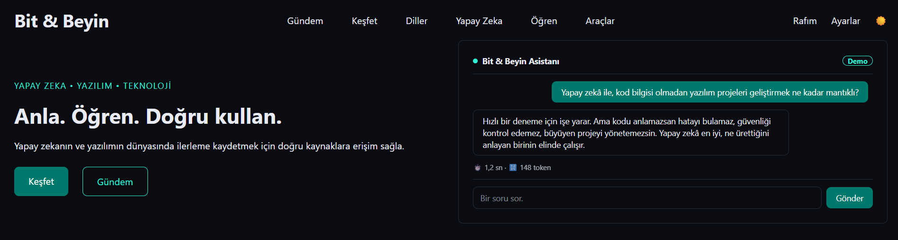

# Bit & Beyin

A Turkish learning portal about AI, software and technology. I'm building it to help people learn about artificial intelligence, and to grow as a frontend developer along the way.

**Live:** [bit-beyin.vercel.app](https://bit-beyin.vercel.app)



## Features

**Done**
- Home page with a hero section, a chat mockup and six category cards
- Light and dark theme that remembers your choice
- Mobile navigation with a hamburger menu
- About page with an accordion and contact section
- Glossary of tech terms, loaded from a JSON file, with search

**In progress**
- Code quiz

The site is planned to grow to 20 pages, including tech news, a developer roadmap and an AI timeline.

## Built with

- HTML
- Tailwind CSS v4 (CLI)
- Vanilla JavaScript
- Vercel for hosting (every merge to `main` is deployed automatically)

## Run it locally

```bash
git clone https://github.com/vyslaln/bit-brain.git
cd bit-brain
npm install
npm run dev
```

`npm run dev` watches `src/input.css` and builds `public/css/output.css`. Open `public/index.html` with a local server (for example the Live Server extension in VS Code). The glossary uses `fetch`, so it won't work if you open the file directly.

## How I work on it

Every change goes through its own branch and pull request before it reaches `main`. I keep a learning journal of what I build and learn in [`docs/LEARNING-JOURNAL.txt`](docs/LEARNING-JOURNAL.txt) (in Turkish).